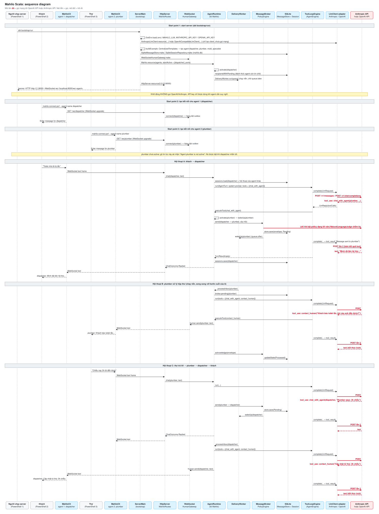

# Sequence diagram của Mahilo Scala



**Mũi tên đỏ** là các lần gọi mạng tới OpenAI API (`POST /v1/chat/completions`) hoặc Anthropic API (`POST /v1/messages`), tuỳ `MAHILO_LLM`.
Nét liền là gọi, nét đứt là trả về.

Các điểm bắt đầu:

1. **Start server** (`sbt bootstrap/run`). `ServerMain` đọc `.env`, tạo LLM client, tạo các agent từ `CentralizedTemplates` (dispatcher, plumber, mold_specialist), mở SQLite, bật dispatcher, chạy `DeliveryWorker` nền rồi mở HTTP ở cổng 8000. Bước này **không** gọi API nào.
2. **Agent 1 (dispatcher)**: khách mở `mahilo-connect.ps1 --agent-name dispatcher`, CLI nối WebSocket `/ws/dispatcher`.
3. **Agent 2 (plumber)**: thợ mở `mahilo-connect.ps1 --agent-name plumber`, CLI nối WebSocket `/ws/plumber`.

Agent được tạo ngay lúc start server. Ở bước 2 và 3, mỗi terminal chỉ mở một kết nối tới agent đã có sẵn, nên cũng chưa gọi API. Các mũi tên đỏ chỉ xuất hiện trong ba đoạn hội thoại phía sau:

- **A**: khách nhắn dispatcher. Dispatcher gọi tool `chat_with_agent`, tin nhắn được lưu vào hàng đợi (SQLite).
- **B**: `DeliveryWorker` đánh thức plumber để xử lý hộp thư. Plumber gọi `contact_human`, câu hỏi hiện ở terminal của thợ.
- **C**: thợ trả lời. Plumber gửi tin lại cho dispatcher, rồi dispatcher gọi `contact_human` để báo khách.

Mỗi lượt suy nghĩ của agent (`ToolLoopEngine`) thường gọi API hai lần: lần đầu Claude/GPT yêu cầu chạy tool, lần sau nó nhận kết quả của tool và trả lời. Ngoài ra còn một mũi tên đỏ tuỳ chọn: `PolicyEngine` chỉ gọi API khi bạn bật một policy dạng lời văn (`MAHILO_POLICIES`).

## Sửa sơ đồ

Nội dung sơ đồ nằm trong `diagrams/sequence.py` (danh sách `STEPS`). Sau khi sửa, chạy lại script này để sinh lại cả hai file:

```
python3 docs/diagrams/sequence.py
```

- `diagrams/sequence.svg`: ảnh, GitHub hiển thị trực tiếp.
- `diagrams/sequence.puml`: bản PlantUML. Bạn có thể dán vào https://www.plantuml.com/plantuml hoặc dùng plugin PlantUML của IntelliJ/VS Code để xuất PNG/PDF.
